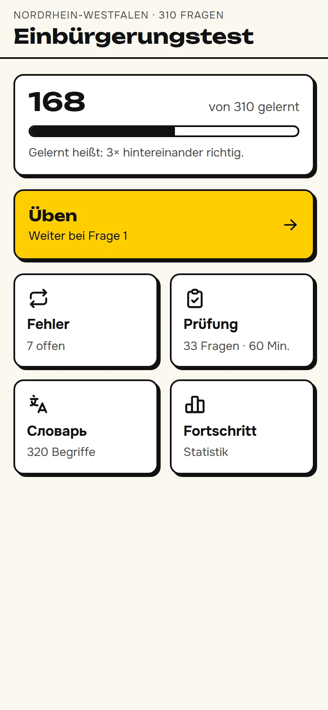
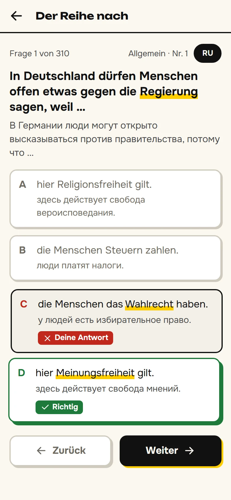
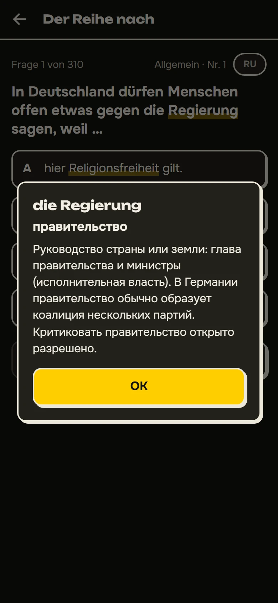
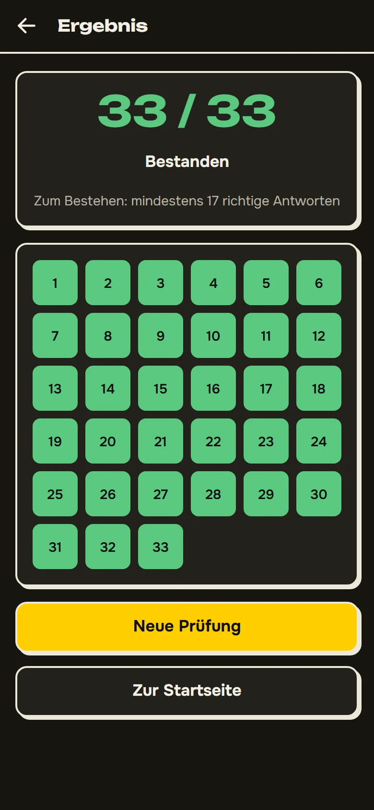
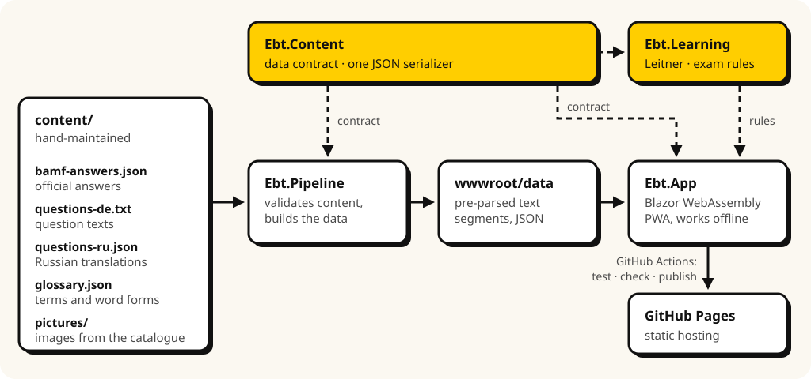

# 33 von 33

*Not 17 out of 33 to pass – all of them.*

[](https://github.com/temvarin/33-von-33/actions/workflows/ci.yml)
[](LICENSE.md)

A practice app for the German citizenship test (*Einbürgerungstest*) with all 310 official questions for Nordrhein-Westfalen, a Russian glossary and a Russian translation of every question. It is an offline-capable web app (PWA) built with Blazor WebAssembly and a .NET content pipeline.

**[Open the app →](https://temvarin.github.io/33-von-33/)** – and add it to your home screen to use it like an installed app ([how](#install-on-a-phone)).

| Home | Practice | Glossary | Mock exam |
|:---:|:---:|:---:|:---:|
|  |  |  |  |

## Why

The official test asks 33 of the 310 questions in 60 minutes and passes at 17 correct answers. This app aims for all of them, so the exam becomes a formality. It is written for learners whose first language is Russian: the questions stay in German, as in the exam, with Russian help one tap away.

It is a web app rather than a store app: one codebase that installs on iPhone and Android, works offline, and needs no account, no app store and no Mac to build.

Correctness matters more than features here: a wrong answer in a practice app gets learned. Every answer comes from the official catalogue, and every glossary entry was checked against dictionaries and references (see [content sources](#content-sources)).

## Features

- **Practice** in order, shuffled or only unseen questions, or jump to a question number. Answers give immediate feedback.
- **Mistakes review** with Leitner boxes: a question counts as learned after three correct answers in a row.
- **Mock exam** following the official rules: 30 general and 3 NRW questions, 60 minutes, feedback only at the end, German only.
- **Russian help:** 320 glossary terms highlighted in the questions, each with a Russian explanation one tap away, and a translation of every question and answer. No translation gives away the correct answer – the pipeline enforces it.
- **Progress statistics** and the history of mock exams.
- **Works offline**, installs to the home screen on iPhone and Android, follows the phone's dark mode. No account and no tracking: progress stays in the browser.

## Install on a phone

- **iPhone:** open the app in **Safari** → Share → *Add to Home Screen*.
- **Android:** open the app in **Chrome** → ⋮ menu → *Add to Home screen* → *Install*.

Then open it once while online so everything is cached for offline use. Updates arrive in the background and take effect the next time the app is opened after being closed.

## Engineering highlights

- **One domain, two consumers.** `Ebt.Domain` holds the content types and the learning rules. The pipeline writes the app's data with the same types the app reads it with, so a change to the data format breaks the build, not the app.
- **Content is validated like code.** The pipeline checks the sources against content rules, pre-parses all text so the app does no parsing, and CI fails if the committed data differs from what the sources produce.
- **Encapsulated domain state.** State changes only through domain methods (`Record`, `StartExam`, `Exam.Answer`); setters are internal and exist for source-generated JSON.
- **Deterministic tests.** Clock (`TimeProvider`) and randomness are injected, so the domain is tested with xUnit and the components with bUnit against a fake clock.
- **Trimming-safe and lean.** Source-generated JSON instead of reflection, no ICU culture data, self-hosted fonts subset to Latin and Cyrillic.
- **Offline by design.** The service worker precaches every file of a release, verifies each against its build-time hash and serves the app from a versioned cache.
- **Strict build.** .NET analyzers at the recommended level, warnings are errors.
- **Accessible.** Every text colour meets WCAG AA in light and dark mode, colour is never the only signal, and motion respects *reduce motion*.

## Architecture

One .NET 10 solution: a Blazor WebAssembly app and a content pipeline that share a domain library.

<picture>
  <source media="(prefers-color-scheme: dark)" srcset="docs/diagrams/architecture-dark.svg">
  
</picture>

- **Ebt.Domain** (`src/Ebt.Domain`): the content types and the learning rules – Leitner boxes, mock exam, stored progress with a schema version. No UI, no I/O; clock and randomness are passed in.
- **Ebt.Pipeline** (`src/Ebt.Pipeline`): owns all content processing. It validates the sources against the content rules, finds glossary terms in the German text and writes the app's data as segments with the domain types. `check` fails CI if the committed data differs from what the sources produce.
- **Ebt.App** (`src/Ebt.App`): Razor components on top of the domain. Services (catalog, progress, dialogs, clock, randomness) are injected.

### Repository layout

```
src/
  Ebt.Domain/            content types, Leitner progress, mock exam, progress storage
  Ebt.App/               Blazor WebAssembly PWA: pages, components, services
    wwwroot/data/        generated by the pipeline – do not edit
  Ebt.Pipeline/          console tool: build, check, fetch-images, translation-report
tests/
  Ebt.Domain.Tests/      xUnit
  Ebt.App.Tests/         bUnit component tests
  Ebt.Pipeline.Tests/    xUnit
content/                 answers, texts, translations, glossary, pictures, review logs,
                         and the browser script that captures the official answers
docs/                    screenshots and diagrams for this README
```

## Development

Requires the .NET 10 SDK and, for publishing, the WebAssembly build tools:

```bash
dotnet workload install wasm-tools
```

```bash
dotnet run --project src/Ebt.App      # http://localhost:8080
dotnet test
dotnet publish src/Ebt.App -c Release -o publish
```

The service worker only caches in the published app; in development every request goes to the server.

### Changing content

Edit the files in `content/`, then rebuild the app's data:

```bash
dotnet run --project src/Ebt.Pipeline -- build
```

`build` refuses to write data that breaks a content rule and lists the problems. `translation-report` lists translations that don't use the glossary's Russian term – a heuristic for manual review, since Russian case endings cause false alarms.

Time-sensitive glossary facts to revisit: Federal President (Steinmeier's term ends 18 March 2027), Chancellor, party line-up, Kindergeld amount, EU/euro/Schengen member counts.

### If the BAMF changes the catalog

1. Re-capture the answers with `content/capture-bamf-answers.js` (instructions in the file) into `content/bamf-answers.json`.
2. `dotnet run --project src/Ebt.Pipeline -- fetch-images` downloads the question images; picture questions are copied to `content/pictures/`.
3. Update `questions-de.txt` (transcribed from the images), translations and glossary for changed questions; `build` reports anything missing.

## Deployment

Every push to `main` runs CI (`.github/workflows/ci.yml`): tests, the data check, and a Release publish. If everything passes, the app is deployed to GitHub Pages; the deploy job sets the `<base href>` to the Pages path and adds a `404.html` so links like `/exam` work. One-time setup in the repository: *Settings → Pages → Build and deployment → Source: **GitHub Actions***.
## Content sources

Questions and official answers: Bundesamt für Migration und Flüchtlinge, [oet.bamf.de](https://oet.bamf.de) (Bundesland NRW). Glossary entries were checked against German–Russian dictionaries and German and Russian references; the sources per entry are in `content/glossary-sources.json`, every translation correction is logged with its reason in `content/translation-review.json`.

This is a private project, not an official BAMF product.

Fonts: [Onest](https://github.com/googlefonts/onest) and [Unbounded](https://github.com/googlefonts/unbounded) (SIL Open Font License, see `src/Ebt.App/wwwroot/fonts/`). Icons: [Tabler Icons](https://tabler.io/icons) (MIT).

## License

Source-available under the [PolyForm Noncommercial License 1.0.0](LICENSE.md): you may read, run and adapt it for noncommercial purposes, but not sell it or use it commercially. The official question catalogue, the fonts and the icons keep their own terms; see [THIRD-PARTY-NOTICES.md](THIRD-PARTY-NOTICES.md).
